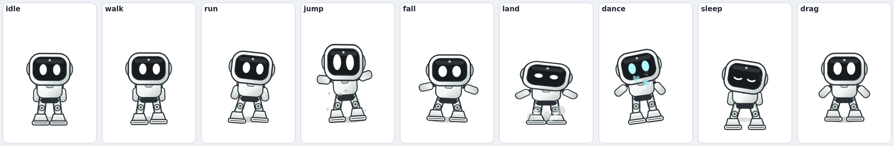

# Desktop Buddy 🤖👻🐾

Tiny creatures that live on your Ubuntu desktop.

**Bolt** is a soft-edged desktop robot with a large rounded screen face, two
luminous eyes, a compact white shell and oversized boots. It walks around,
dances on your browser's search bar, hangs out near your terminal prompt,
investigates your cursor, and **looks after you** with gentle wellness reminders.
**Boo-ombastic** the ghost and **Mochi** the original blob-cat remain available.

Works best on **X11 / "Ubuntu on Xorg"**. See [Wayland](#wayland) below.



---

## Features

- Frameless, transparent, always-on-top window — no taskbar entry, no focus stealing
- Autonomous behaviour: idle breathing, blinking, looking around, walking, running,
  jumping (gravity + squash & stretch), landing dust, dancing, sleeping with `Zzz`
- **Dance mode**: Boo bobs, sways, sings `♪♫` and throws hearts (double-click,
  tray → Dance!, or `desktop-buddy dance`)
- **Window perching**: when you use a browser it climbs onto the window near the
  address/search bar; with a terminal it settles near the prompt; switch apps and
  it comes back down (tray → "Perch on browser/terminal" to disable)
- **Drop it anywhere**: drag the buddy anywhere on the screen — floor, middle of
  the screen, top edge, on top of another window
- **Three characters**: Bolt the articulated robot, Boo-ombastic the ghost and
  Mochi the cat — switch live from the tray or with `desktop-buddy character robot|ghost|mochi`
- **Wellness reminders**: breakfast 09:00, lunch 13:30, optional snack 16:30,
  dinner 21:00, wind-down 23:00, water every 45 min and a stretch break every
  60 min (both only during your active hours, 09:00–22:30 by default)
- Reminders arrive with a dancing Boo, a speech bubble, themed particles
  (water droplets, hearts, notes), a gentle chime and a card with
  **Done** / **Snooze 10m** buttons; snoozed reminders come back on time
- Eyes follow the cursor; the buddy chases it when playful
- Drag & throw with real physics; double-click for a happy hop; `Ctrl`+wheel to resize
- Right-click menu and a system-tray icon (GNOME AppIndicator)
- Six-tab preferences dialog with theme and animation-state previews, platform
  capability status, and import/export/reset controls
- First-run onboarding for character, size, reminder hours and login startup
- Reduced motion, silent mode and do-not-disturb attention controls
- 7 colour themes, adjustable size / speed / frame rate / sleep timeout
- Adaptive frame rate and a battery saver (lower fps on battery)
- Remembers its position and settings between sessions
- Single instance: launching again just shows the existing buddy
- Platform-backed autostart entry so it comes back when you log in
- All artwork drawn procedurally with `QPainter` — crisp at any scale (including
  your 2.5× fractional HiDPI setup), no bitmap assets to ship

## Install

Everything is user-level; **no sudo needed**.

```bash
cd ~/desktop-buddy
./install.sh                 # add --no-autostart to skip login startup
```

The installer:

1. creates a Python 3.12 virtual environment in `.venv/` and installs PyQt6;
2. vendors `libxcb-cursor` into `vendor/syslibs/` if your system lacks it
   (Qt ≥ 6.5 needs it for the X11 platform plugin — this machine was missing it);
3. installs the launcher `~/.local/bin/desktop-buddy`;
4. installs the application-menu entry;
5. enables autostart (`~/.config/autostart/desktop-buddy.desktop`).

> If the `desktop-buddy` command is not found right away, your shell's `PATH`
> predates the new `~/.local/bin` directory. Use `~/.local/bin/desktop-buddy`
> or log out/in once (Ubuntu adds it automatically at login).

## Usage

```bash
desktop-buddy            # start it (or show it if already running)
```

Then:

| Action | How |
| --- | --- |
| Move it anywhere | Drag with the left mouse button, release to throw |
| Make it dance (Boo) | Double-click it, tray → Dance!, or `desktop-buddy dance` |
| Menu | Right-click it, or click the tray icon |
| Resize | `Ctrl` + mouse wheel |
| Change character | Tray → Character → Bolt / Boo-ombastic / Mochi |
| Wellness reminders | Tray → Reminders (on/off, chime, Water now, Stretch now, Upcoming…) |
| Preferences | Tray menu → Preferences… (or `desktop-buddy settings`) |

### Command line

```bash
desktop-buddy quit | show | hide | toggle | pause | resume | dance | settings
desktop-buddy status                    # what is the buddy doing right now?
desktop-buddy character robot|ghost|mochi  # switch characters
desktop-buddy reminders status          # next reminders, in order
desktop-buddy reminders on|off          # pause/resume wellness reminders
desktop-buddy remind water              # fire a reminder now (water/lunch/break/…)
desktop-buddy click-through on|off     # let clicks pass through to apps below
desktop-buddy autostart on|off|status
desktop-buddy --diagnose               # environment/support report
desktop-buddy --reset-config           # wipe settings and start fresh
desktop-buddy --version
```

All control commands talk to the running instance over a local socket — a
second launch never spawns a duplicate buddy.

## Configuration

Settings live in `~/.config/desktop-buddy/config.json` (edited via the GUI,
but hand-editable too):

| Key | Default | Meaning |
| --- | --- | --- |
| `schema_version` | `2` | Persisted-format version used for automatic upgrades |
| `name` | `"Bolt"` | Displayed in the greeting/about |
| `species` | `"robot"` | `robot` (Bolt), `ghost` (Boo) or `mochi` (the cat) |
| `theme` | `"circuit"` | `circuit`, `mint`, `peach`, `lavender`, `sky`, `sakura`, `charcoal` |
| `scale` | `0.8` | 0.5 – 1.8 |
| `speed` | `1.0` | 0.4 – 2.5 |
| `fps` | `30` | 10 – 60 (adaptive; idles at ≤ 15) |
| `always_on_top` | `true` | Keep above other windows |
| `click_through` | `false` | Mouse input passes through to apps below |
| `reduce_on_battery` | `true` | 20 fps active / 12 fps idle on battery |
| `reduced_motion` | `false` | Disable runs, jumps, dances and particles |
| `silent_mode` | `false` | Disable all application sounds |
| `do_not_disturb` | `false` | Pause automatic reminder interruptions |
| `playful` | `true` | Chase the cursor sometimes |
| `can_sleep` | `true` | Nap after being idle |
| `sleep_after` | `180` | Seconds of no interaction before sleeping |
| `perch_on_windows` | `true` | Sit on the focused browser/terminal window |
| `perch_delay` | `1.2` | Seconds a window must stay focused before climbing |
| `reminders_enabled` | `true` | Master switch for all wellness reminders |
| `reminder_sound` | `true` | Play a gentle generated chime |
| `breakfast_time` | `"09:00"` | Breakfast reminder (also `lunch_time` 13:30, `snack_time` 16:30, `dinner_time` 21:00, `winddown_time` 23:00) |
| `water_interval_minutes` | `45` | Water reminder interval |
| `break_interval_minutes` | `60` | Stretch reminder interval |
| `active_start` / `active_end` | `"09:00"` / `"22:30"` | Window in which interval reminders may fire |
| `reminder_grace_minutes` | `45` | How late a missed scheduled reminder may still fire |
| `snooze_minutes` | `10` | Default snooze length on the reminder card |
| `position_x` | auto | Last position on screen |

## Performance

The Phase 0 baseline is recorded in [BENCHMARKS.md](BENCHMARKS.md). On the
reference i5-13500H Linux/X11 system, startup to first paint is about 174 ms,
idle use is about 4% of one core, and active movement is about 7% of one core.

Summary:

| State | CPU (one core) | Memory | Startup |
| --- | --- | --- | --- |
| First paint (offscreen check) | — | — | ~174 ms |
| Active (walking/dancing/perched) | ~7 % | ~85 MB | — |
| Idle / sleeping | ~4 % (adaptive fps) | ~85 MB | — |
| Paused or hidden | ~1 % | ~85 MB | — |

The window is only ~112 × 128 logical pixels, so even where it overlaps other
windows it blocks almost nothing.

The reminder scheduler wakes up every 20 seconds and costs effectively nothing.

## Troubleshooting

### Wayland
GNOME Wayland does not let ordinary applications position themselves, force
themselves always-on-top, or set click-through. The buddy will still run, but
it will be stuck where the compositor puts it. **Log in with "Ubuntu on Xorg"**
for the full experience. `desktop-buddy --diagnose` prints your session type.

### Click-through is on and I can't click the buddy
Use the tray icon, or run:

```bash
desktop-buddy click-through off
```

Click-through uses X11 input shapes; a few compositors handle these oddly, so
treat it as best-effort. Everything else works with normal clicks.

### No tray icon
GNOME needs the AppIndicator extension (installed by default on Ubuntu). Even
without it, right-clicking the buddy opens the same menu.

### Qt complains about the `xcb` platform plugin
Re-vendor the missing library:

```bash
./scripts/fetch_qt_syslibs.sh
```

or install it system-wide with `sudo apt install libxcb-cursor0`.

### Logs and diagnostics

```bash
desktop-buddy --diagnose
tail -f ~/.local/state/desktop-buddy/desktop-buddy.log
```

### Reminders don't fire
- Check `desktop-buddy reminders status` for the next scheduled times.
- Water/stretch reminders only fire between `active_start` and `active_end`
  (default 09:00–22:30); meals fire at their fixed times.
- If the laptop was asleep at a meal time, Boo still reminds you within the
  grace window (45 min by default) when you come back.
- No chime? Check that the system has an available audio output. Reminder audio
  now uses Qt Multimedia and does not require an external player command.

## Uninstall

```bash
./uninstall.sh            # removes launcher, menu entry, autostart
./uninstall.sh --purge    # also deletes settings and logs
```

The project folder (including `.venv/`) is left alone; delete it manually if
you want it gone.

## Project layout

```
desktop_buddy/
  app.py            CLI, controller, single-instance IPC, diagnostics
  window.py         transparent always-on-top window, input, painting loop
  behavior.py       pure-python physics + state machine (unit-tested)
  character.py      procedural QPainter characters (Bolt + Boo + Mochi)
  effects.py        dust, sparkles, hearts, Zzz, music notes, wisps
  platforms/        capability interface and Linux/X11 implementation
    base.py          backend contract, portable paths/audio/IPC identity
    linux.py         X11 probing, workspace behavior, battery and autostart
  wellness.py       meal/water/break schedule + snooze logic (pure, unit-tested)
  toast.py          reminder card with Done/Snooze next to the buddy
  sound.py          generated chime waveforms (played through the backend)
  prefs.py          preferences dialog + live preview
  tray.py           tray icon and shared context menu
  config.py         JSON settings, themes, validation
  platform_utils.py compatibility wrappers for backend calls
install.sh / uninstall.sh / run.sh
scripts/fetch_qt_syslibs.sh
tests/              unittest suite (no display required)
tools/preview.py    renders a pose/theme sheet to PNG
```

## Development

```bash
.venv/bin/pip install -e '.[dev]'       # one-time development setup
./scripts/check.sh                      # format check, tests, package build
.venv/bin/python tools/preview.py /tmp/buddy-preview.png
./run.sh --diagnose
```

The behaviour engine (`behavior.py`) has no Qt dependency, so the physics and
state machine can be tested headlessly.

The supported Phase 0 feature set and known constraints are maintained in
[docs/BASELINE.md](docs/BASELINE.md).

## Changelog

**1.3.0**
- New default character: **Bolt**, a soft-edged desktop companion with a large
  expressive screen, luminous eyes, molded shell, oversized boots and
  state-specific animation.
- New Circuit White theme and robot artwork for the app icon, tray, live
  preferences preview and pose-sheet tool. Boo and Mochi remain selectable.

**1.2.0**
- Wellness reminders: breakfast, lunch, snack, dinner, wind-down, water and
  stretch breaks, with active hours, grace window, snooze and daily state.
- Reminder cards with Done / Snooze buttons beside the buddy, plus themed
  animations (water droplets, hearts, music notes, Zzz) and generated chimes.
- Tray "Reminders" menu, preferences group with time pickers and interval
  sliders, and `remind` / `reminders` CLI commands.
- `status` now reports the reminder card state for troubleshooting.

**1.1.0**
- New character: **Boo-ombastic** the ghost (floaty physics, dance mode, music
  notes, wisps) — now the default; Mochi the cat is still selectable.
- Drag the buddy anywhere on screen, including the top edge (the window's local
  foot offset absorbs Mutter's on-screen placement clamp).
- Window perching: detects the focused browser (near the search bar) and
  terminal (near the prompt) and climbs onto it; follows the window when it
  moves and floats back down when you switch away.
- `dance` and `status` commands, tray "Dance!" and "Character" menus.
- Smaller canvas window → ~30 % less CPU while visible.

**1.0.0**
- Initial release: Mochi the cat, tray, preferences, autostart, installer.

## License

MIT — see [LICENSE](LICENSE).
